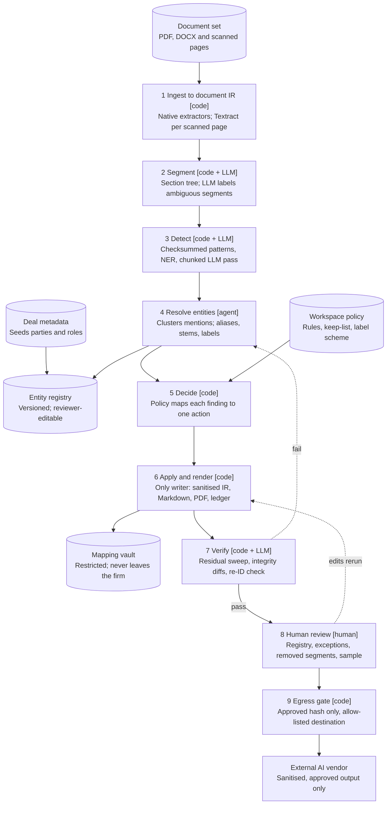

# AutoDoc Document Sanitisation: Architecture

As of 2026-11-19 · Author: Jerin

## Summary

Build sanitisation as a generic **detect → resolve → decide → apply → verify → review → release** pipeline. Models *propose* findings, deterministic code *applies* them, and an independent verifier plus a human *approve* them. No LLM or agent ever writes the outgoing document.

The main platform investments are not a "redaction agent". They are:

- **A span-addressable document model.** This replaces Markdown as the working format.
- **An entity registry.** It is the backbone of label consistency.
- **A declarative policy engine.**
- **A verification stage that is independent of detection.**
- **A governed egress gate.** No workspace can send anything outside the firm without passing it.

The credit-agreement use case is then mostly configuration: a policy file, detector settings, allow-lists, segment rules, prompts and a golden test set.

The biggest problem with the framing: this produces *pseudonymised* documents, not anonymous ones. With amounts, dates and deal-specific covenants left in, many public-borrower deals can be re-identified from public filings. That residual risk has to be accepted explicitly by Legal and Compliance. It cannot be engineered away without destroying the covenant data the vendor needs.

## Where the framing is wrong or hides assumptions

1. **"Remove personal info + label entities" is pseudonymisation, not anonymisation.** Keeping the facility amount, closing date, pricing grid, industry-specific EBITDA add-backs, named acquisitions and sponsor language leaves a fingerprint. Many syndicated credit agreements for public borrowers are filed publicly as exhibits on EDGAR, so a determined reader can match them. Decide the acceptable residual risk with Legal and Compliance up front. Also have them confirm that each agreement's own confidentiality clause permits disclosure to this vendor, and whether any deals are private-side or carry MNPI.
2. **Role labels conflict with "same entity, same label".** One bank is often Administrative Agent, Collateral Agent, L/C Issuer, Swingline Lender, Lead Arranger and a Lender at once. Label the **entity** with a neutral pseudonym ("Bank A"), not the role. The document already supplies role pseudonyms: "Acme Holdings, Inc. (the "Borrower")" means every later "the Borrower" is already safe. **Do not rewrite role-based defined terms.** Replace only real names and the defined terms derived from them ("Acme Parent" becomes "[Borrower 1] Parent"). Rewriting "the Borrower" or "Required Lenders" would damage the covenant language you are trying to preserve.
3. **The label's form is a modelling decision, not cosmetics.** If the vendor's model will later run on *unsanitised* production documents, bracketed tokens like "[Lender 03]" create a train/serve distribution shift. Realistic synthetic names ("Northwind Holdings, Inc.") preserve the distribution but are harder for reviewers to spot and can collide with real companies. Make the surrogate strategy a policy setting, and ask the vendor which one they need.
4. **An agent with grep and read is the wrong shape for the redactor.** Its coverage cannot be proven, it is not reproducible run to run, and a 400-page document exceeds what it can hold in context at once. Agents should *discover* entities and produce a small, reviewable registry. Deterministic code should apply it.
5. **Markdown should not be the working format.** It loses page and position provenance, which the side-by-side review needs, and some converters silently drop channels such as headers, footers, footnotes, tracked changes and text inside images. Use a span-addressable intermediate representation (IR). Treat Markdown as one rendering of it.
6. **"Remove whole sections" should leave a typed placeholder, not a gap.** For example: `[REMOVED: Payment Instructions]`. This keeps numbering and cross-references coherent, and tells the vendor's model the content was withheld rather than absent.
7. **A side-by-side view does not make a 400-page review feasible.** Nobody reads 400 pages diligently per document. The review must be driven by exceptions and the entity registry, with sampling for the rest (see the reviewer section).
8. **"Generic" has a ceiling.** The reusable parts are the pipeline primitives, the detector framework, the registry, policy, verification and egress. Don't try to make the prompts or segment rules generic. Those are rightly per-workspace configuration.
9. **Check whether the documents need to leave the firm at all.** If the vendor's engineers can work inside a firm-controlled environment, sanitisation only governs the models and outputs that leave, which is a much smaller problem.

## End-to-end architecture

Nine stages run as one Temporal workflow per document set. Each stage passes versioned artifact references (IR, findings, registry, decisions) rather than text.

A verification failure loops back to entity resolution. A reviewer's edit becomes a registry or rule change, and applying and verifying rerun over the whole set. Only stage 6 ever writes output bytes.

- **1 Ingest.** Detect file type and route each page to native extraction or Textract. Pull every hidden channel (metadata, comments, tracked changes, headers and footers, footnotes, hyperlinks, form fields, embedded files) into the IR. Tag everything here as restricted.
- **2 Segment.** Build the section tree (articles, sections, schedules, exhibits, signature pages) from configured patterns. A bounded LLM call classifies segments the patterns can't, such as payment instructions vs a blank assignment form.
- **3 Detect.** Detectors run in parallel and emit findings. Chunked LLM detection runs as a map-reduce stage of child workflows.
- **4 Resolve.** The agent builds the entity registry from deal metadata, high-signal regions and the detectors' mentions. Its output is a proposal; it never edits text.
- **5 Decide.** The policy engine turns findings and registry entries into decisions. Every decision records the rule that produced it.
- **6 Apply and render.** Resolves overlapping spans, applies decisions, and renders fresh Markdown and (if needed) a truly redacted PDF. It writes the change ledger and the label-to-name mappings to the vault.
- **7 Verify.** Checks the output from scratch, without trusting stages 3–6. Produces a risk score and a pass or fail decision.
- **8 Review.** The reviewer approves the registry and the exceptions; approval is bound to the output hash.
- **9 Egress.** Sends only the approved, hash-matching artifact to an allow-listed destination, with a manifest and audit record.

## Platform vs workspace configuration

The test for the split: if a second workspace (say, KYC packs or NDAs) needs it unchanged, it is platform; if it encodes knowledge of credit agreements or this vendor, it is configuration.

| Capability | Generic platform component | Credit-agreement workspace config |
| --- | --- | --- |
| Document model | **Document IR**: blocks (heading, paragraph, table cell, image, header/footer, footnote, signature region) with stable IDs, character offsets, page + bounding box, and source (native or OCR) with confidence. Every extractor emits it; Markdown, redacted PDF and DOCX are renderings. | None |
| Ingestion | Per-page routing between native extraction and Textract. Mandatory extraction of hidden channels: metadata, comments, tracked changes, hyperlinks, embedded files, form fields. | Tracked-changes policy (reject unaccepted changes or fail), whether images are dropped or pixel-redacted |
| Segmentation | **Segmenter**: builds a section tree from configurable heading patterns, with an LLM classifier for segment types | Patterns (ARTICLE, Section 7.11, SCHEDULE 2.01, EXHIBIT C), segment taxonomy (payment instructions, notices, signature page, administrative questionnaire, commitments schedule) |
| Detection | **Detector framework**: pluggable detectors emitting *findings* (span, category, confidence, evidence, detector ID). Built-in types: regex + checksum validators, gazetteer, NER model, chunked LLM detector, segment classifier. | Which detectors run, thresholds, category list, domain prompts, gazetteers (bank names, law firms, sponsors) |
| Identifiers | Validator library: CUSIP and ISIN check digits, LEI and IBAN mod-97, ABA routing checksum, SWIFT/BIC format, Luhn, email, phone, URL | Which identifier types to mask, plus context patterns ("Account No.", "Ref:", "Attn:", LoanX ID, ClearPar ID, deal codes) |
| Consistency | **Entity registry** service: canonical entities, types, roles, aliases, name stems, labels, provenance. Versioned, scoped to a document *set*, editable by reviewers. | Entity types (Borrower, Guarantor, Parent, Subsidiary, Sponsor, Agent bank, Arranger, Lender, Counsel, Auditor), label templates, seeding from deal metadata |
| Policy | **Policy engine**: declarative rules mapping category to action (KEEP, PSEUDONYMISE, MASK, REDACT, REMOVE_SEGMENT, FLAG), conflict priority, surrogate strategy, consistency scope, review thresholds. Versioned, with every decision traceable to a rule. | The policy file itself, including the **keep-list**: role-based defined terms, public reference entities (rating agencies, SOFR and its administrator, the Federal Reserve Bank of New York, governing-law jurisdictions) |
| Transform | **Deterministic applier and renderer**: resolves overlapping spans, applies decisions to the IR, renders fresh output, writes a change ledger | Placeholder wording, output formats the vendor needs |
| Mapping vault | Encrypted store of label-to-real-name mappings and the change ledger. Restricted access, never eligible for egress. Used to map vendor outputs back. | Retention period, who can access it |
| Verification | **Assurance stage**: residual pattern scan, registry alias/stem sweep with OCR-tolerant matching, integrity diffs, adversarial re-identification LLM pass, risk score, gate decision | Residual-risk thresholds, which checks block vs warn, re-identification prompt |
| Review | **Review workbench**: registry editor, ranked exception queue, side-by-side with provenance, manual redaction that propagates, approval bound to the output hash | Reviewer group, four-eyes rule, sampling rate, checklist |
| Egress | **Governed egress gate**: only sanitised, approved, hash-matching artifacts reach allow-listed destinations; immutable audit log | Vendor destination, approvers, per-batch manifest |
| Quality | **Evaluation harness**: golden annotated sets, recall and precision per category, regression gate on any prompt, model or config change | 20–30 hand-annotated credit agreements covering native, scanned and mixed documents, LSTA and LMA forms |

Three additions to AutoDoc's pipeline engine itself are needed:

- **A deterministic "function" stage type.** Today you only have LLM-call and agentic stages. Parsing, applying and verifying must not run as an agent calling tools.
- **A map-reduce stage.** It fans an LLM call out over many chunks and merges the results. A single prompt and response cannot cover 400 pages.
- **A gate/loop stage.** It routes a document back to resolution or to review based on verification results. On Temporal this is a natural workflow with child workflows per chunk.

Stages should pass **typed artifact references** (IR version, registry version, findings set) rather than text blobs. That gives you lineage and makes reruns idempotent.

## Deterministic vs LLM vs agent

The rule: use the cheapest mechanism whose errors you can measure. Anything that touches the outgoing bytes must be deterministic and replayable. Judgement goes to models, but only as proposals.

| Mechanism | Used for | Why |
| --- | --- | --- |
| **Deterministic code** | Extraction to IR, OCR routing, segmentation by pattern, identifier detection with checksums, emails, phones, URLs. Alias and stem propagation once the registry is known. Applying decisions, rendering, the change ledger, the verification sweep, integrity diffs, the egress gate. | Provable coverage, identical output on rerun, auditable to a rule, cheap on 400 pages. Checksums push identifier false positives close to zero, so "$500,000,000" is never masked as an account number. |
| **Bounded LLM calls** (map-reduce over chunks, JSON schema output) | Finding people and organisations in prose with context. Classifying ambiguous segments ("is this block payment instructions or a blank form?"). Disambiguating a candidate span ("is 'Acme' here the borrower or a product brand?"). The adversarial re-identification pass. | Context-dependent judgement that rules miss. Small inputs and structured outputs keep each call checkable and measurable against the golden set. |
| **Agent** (read-only tools, no write or egress tools) | Building the **entity registry**: reading the preamble, Article I definitions, signature pages and commitments/notices schedules; grepping for variants; working out corporate families; merging candidates from the chunked detectors. Optionally, triaging verification failures into proposed registry fixes. | Open-ended, cross-document search and reconciliation. Its output is small (typically 20–150 entities), structured and fully reviewable, so non-determinism is contained. |

Two hard rules follow:

- **No model writes the outgoing document.** Models emit findings or registry edits. The applier is the only writer.
- **Detection and verification use different mechanisms.** The verifier never trusts a detector's output; it checks the sanitised result from scratch. If both use LLMs, they use different prompts, and ideally different models.

All LLM calls run on firm-approved internal endpoints, with pinned model versions. The vendor's own models must never see the unsanitised text.

## Keeping labels consistent across 400 pages

Consistency comes from never letting a model assign a label while it is looking at a chunk. Labels are assigned once, from a registry, and applied by string matching.

1. **Seed the registry from systems of record.** The deal origination system already knows the borrower, guarantors, agent, arrangers and lender group for most deals. Seeded entities start at high confidence.
2. **Read the high-signal regions first.** The agent reads the preamble and parties clause, Article I definitions, signature pages, the commitments schedule, the subsidiaries schedule and the notices schedule. These name almost every entity with its role and full legal name.
3. **Map: chunked detectors emit mentions, not labels.** Each mention carries its surface form, context window, guessed type and location. Chunks overlap so names split across a chunk boundary are not lost.
4. **Reduce: cluster mentions into entities.** First normalise: strip legal suffixes (Inc., LLC, N.A., plc, S.à r.l.), case and punctuation. Then merge by exact match, by known abbreviation ("Bank of America, N.A." with "BofA"), and by fuzzy match. Ambiguous merges go to a single LLM adjudication call with both contexts, and any it is unsure of go to the reviewer. Keep corporate families separate: Acme Holdings, Acme Intermediate and Acme Opco are three entities.
5. **Record name stems as sensitive in themselves.** If "Acme" is the distinctive token of any entity, every occurrence of "Acme" is a finding, including in product names, trademarks, domains (acme.com) and subsidiaries the registry missed. This is the main defence against indirect references.
6. **Assign labels deterministically, once.** For example, number by order of first appearance within each type (Borrower 1, Guarantor 1–4, Bank A…). The label-to-entity mapping must be one-to-one, and that invariant is checked in code.
7. **Apply by matching every alias and stem.** Longest match first, on word boundaries, after normalising whitespace, hyphenation at line breaks, all-caps forms, possessives ("Acme's") and OCR confusion pairs (rn/m, l/1, O/0). Leave role-based defined terms alone; rewrite name-derived defined terms through their alias.
8. **Close the loop.** The verifier sweeps the sanitised output for every alias and stem. Any hit is either a missed alias, which is added to the registry and triggers a re-apply, or a false positive, which goes on the keep-list. Repeat until nothing changes.

**Scope is the document set, not the file.** A credit agreement, its amendments and separately filed schedules share one registry, so "Bank A" means the same bank across all of them. Across different deals, use fresh labels by default. Stable cross-deal pseudonyms would let the vendor link deals together, which raises re-identification risk; allow them only if policy says so.

Because the registry is small, a human reviewing it is the single highest-value review step.

## Failure modes and how they are caught

The principle is defence in depth: every leak has to get past detection, the verifier's independent sweep, a human, *and* the egress gate. Over-redaction gets the same treatment, because a document stripped of its covenant language is a silent failure for the vendor.

| Failure mode | Example | Caught by |
| --- | --- | --- |
| Hidden text channels | Name in DOCX tracked changes, a comment, PDF metadata, a mailto link, white text, text under an image | The extractor must surface every channel into the IR. Output is **rendered fresh from the IR, never redacted in place**, so metadata cannot survive. |
| Mixed native and scanned pages | Native PDF with scanned signature and notice pages | Per-page OCR routing. Every image region is OCR'd or dropped. Signatures, logos and stamps are never sent. |
| OCR errors | "Acrne Holdings" slips past exact matching | OCR-tolerant fuzzy sweep on stems. Pages below a Textract confidence threshold go to mandatory human review. |
| Names split by layout | "Ac-\nme", or a name broken across table cells or pages | Matching on normalised text, not raw lines |
| Missed entity or alias | A subsidiary only named in Schedule 5.13 | Stem sweep, the adversarial re-identification pass, and registry review |
| Wrong merge or split | Two lenders merged under one label, or one bank given two labels | One-to-one invariant in code, LLM adjudication of ambiguous merges, registry review |
| Indirect identifiers | "The largest hospital operator in Tennessee", a named acquisition target, a project codename, a ticker | Adversarial pass: a separate LLM is asked, chunk by chunk, "who is this borrower, and what gives it away?" Hits become findings. What remains is accepted explicitly by the reviewer. |
| Wrong segment boundaries | Half of a wire instruction block survives, or a covenant is deleted with it | Residual sweep for ABA, SWIFT, IBAN, "Attn:" and "Ref:" across the whole output. Every removed segment is shown to the reviewer with its boundaries. |
| Over-redaction | "Required Lenders", "New York" (governing law), SOFR or Moody's replaced | Keep-list. **Integrity diffs**: the set of numbers, percentages and ratios is unchanged apart from masked identifiers; the defined-term inventory is unchanged; inside covenant articles, the only differences are entity substitutions. |
| Loss of usefulness | Covenant extraction quality drops on sanitised text | **Utility check**: run AutoDoc's own covenant extraction on both original and sanitised versions and compare the outputs. |
| Model drift | A model or prompt update lowers recall | Pinned versions. The evaluation harness gates any configuration change on recall per category. |
| Prompt injection from the document | Text in a credit agreement that addresses the model | The agent has read-only tools and no egress. Models never write output. The verifier is independent. |
| Reviewer rubber-stamping | Approving without looking | Required views (below), attestation, and periodically routing a known golden document through the queue to measure reviewer recall |
| Wrong file or destination | The original or the mapping vault is sent, or the wrong bucket | Restricted taint labels on originals, IR and vault. The egress gate only accepts sanitised artifacts whose hash matches the approved one, sent to an allow-listed destination, with a batch manifest. |

The gate blocks on any of: an unresolved high-severity finding, a failed integrity diff, a residual identifier, a page below the OCR threshold that nobody reviewed, or a missing approval.

## What the reviewer sees and does

The reviewer approves a *registry and a list of exceptions*, not 400 pages. The side-by-side view is where they go to check things, not where they start. A target is under 30 minutes per document once tuned.

**Required views, in order:**

1. **Entity registry.** One row per entity: label, type, roles, legal name, aliases found, mention count, where it was first seen, source (deal metadata, agent or detector), and confidence. Actions: merge, split, retype, add alias, mark as keep, or add an entity they spotted.
2. **Exception queue, ranked by risk.** It contains low-confidence findings, verifier hits, adversarial re-identification findings, low-OCR pages, image regions, suspected over-redaction and integrity-diff failures. Each item has accept, reject or edit.
3. **Removed segments.** Each removed block is shown with its boundaries and the rule that removed it.
4. **High-risk pages, always shown.** Cover page, preamble, signature pages, notices schedule, commitments schedule.
5. **Sampled pages.** A risk-weighted random sample, so that review also covers what the system *didn't* flag.

**Side-by-side view:** original on the left, sanitised on the right, scrolling together and anchored by the IR's page and position provenance. Changes are colour-coded by action (pseudonymised, masked, removed, flagged-but-kept). Hovering shows the rule, detector and confidence. It can be filtered by category or entity, with a jump list.

**Edits propagate.** Selecting missed text and marking it creates a registry alias or a one-off rule, never a single local fix. The applier and verifier then rerun over the whole document set, and the reviewer sees what else changed.

**Approval.** The reviewer signs an attestation, and the approval is bound to the output hash. Any later change voids it. A second approver (Compliance, at least for the first batches) releases to the vendor; later this can move to sampling. Every correction is written back as labelled data for the evaluation harness and as proposed keep-list or pattern updates, which are versioned and reviewed before they change the workspace config.

## Assumptions and open questions

**Assumptions**

- Legal and Compliance will define the residual-risk standard and confirm sharing is permitted under each agreement's confidentiality clause and the vendor contract (retention, no training on the data outside this engagement, data location).
- A firm-approved internal LLM endpoint is available for detection, resolution and verification.
- Deal metadata (parties and roles) can be read to seed the registry.
- Volume is in the tens to low hundreds of documents, so a human review of every document is affordable. At thousands, move to risk-based sampling with stronger automated gates.
- Documents are in English and follow LSTA- or LMA-style forms.
- Turnaround is measured in hours to days, not seconds.

**Open questions for the business and the vendor**

- [ ] What format does the vendor need: Markdown, redacted PDF, or both? Do they need page and position data for their own evaluation?
- [ ] Will the vendor's model run on unsanitised documents in production? That decides tokens vs realistic synthetic names.
- [ ] Are dates (closing, maturity) acceptable as-is, or should they be shifted consistently within each deal?
- [ ] Are sponsor names, law firms and auditors in scope for pseudonymisation? (Recommendation: yes, because they are strong identifiers.)
- [ ] Are any of these deals private-side or MNPI-bearing, and does the Control Room need to sign off?
- [ ] Who owns the policy file, and who approves changes to it?

## Build order

Build the parts that make the system *measurable and safe* before the parts that make it clever.

1. **Golden set and evaluation harness.** Hand-annotate 20–30 agreements. Without this, no one can say whether the system works.
2. **Document IR, per-page OCR routing and hidden-channel extraction.** Everything else addresses spans in it.
3. **Function, map-reduce and gate stage types** in the pipeline engine.
4. **Deterministic layer:** identifier validators, policy engine, applier and renderer, mapping vault.
5. **Egress gate with taint labels.** Build it early, so nothing can leave through a side door while the rest is immature.
6. **Entity registry, the resolution agent and the chunked LLM detectors.**
7. **Verifier:** residual sweep, integrity diffs, adversarial re-identification pass.
8. **Review workbench** on top of the planned side-by-side view: registry editor first, then the exception queue.

A first credit-agreement batch can ship after step 7 with a heavier manual review. Step 8 is what makes review sustainable.
