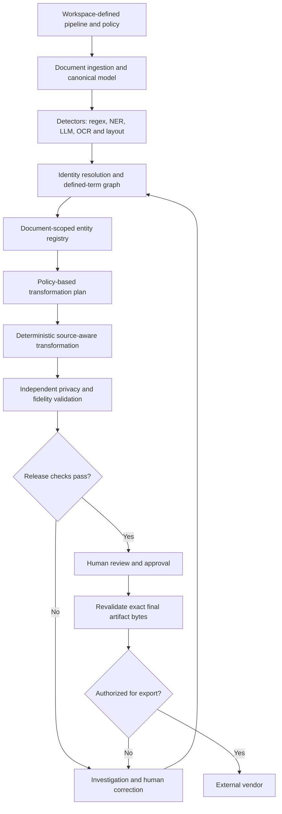

# AutoDoc Document Sanitisation — Research Review

**Date:** 20 November 2026  
**Scope:** Sanitisation of long-form syndicated credit agreements prior to sharing with an external AI vendor, using reusable AutoDoc platform capabilities.

## Executive summary

A hybrid architecture is the best candidate for evaluation: combine deterministic identifier detection and transformation, model-based identification of context-dependent information, document-level entity resolution, physical file redaction, independent validation, and human approval.

The research distinguishes three problems that should not be conflated:

1. **Detection:** Find personally identifiable information, legal entities, identifiers, and sensitive sections.
2. **Identity consistency:** Recognize that different names, abbreviations, defined terms, and indirect references refer to the same entity.
3. **Secure removal and fidelity:** Ensure the exported file contains no recoverable prohibited information while preserving covenant language, ratios, tables, and relevant legal structure.

There is no single demonstrated, off-the-shelf solution that guarantees all three for 200–400-page syndicated credit agreements across native PDFs, Word files, and scans. Published results on legal de-identification are promising but do not establish document-level release safety for this use case.

## 1. Approaches in the literature and practice

| Approach | Representative work / tooling | Relevance to AutoDoc |
|---|---|---|
| Named entity recognition and coreference resolution | PSILENCE; legal-document anonymisation research | Linking borrower, lender, agent, signatory names and aliases |
| Context-aware masking and pseudonymisation | Text Anonymization Benchmark (TAB) | Measuring privacy against retained document usefulness |
| Hybrid rules, patterns, and machine learning | Microsoft Presidio | Reusable detector framework, including custom account/CUSIP recognizers |
| Document-scoped identity mapping | CON-QA | Keeping identity mappings internal before cloud AI processing |
| OCR plus coordinate-level redaction | AWS intelligent document-processing examples | Scans, signature pages, image-embedded sensitive information |
| Physical PDF redaction | PyMuPDF | Removing source content rather than covering it visually |
| Specialised legal-domain models | K-LegalDeID | Motivation to evaluate domain-adapted detectors rather than rely on prompts alone |

## 2. Research papers to read

### 2.1 PSILENCE: A Pseudonymization Tool for International Law (2024)

**Source:** https://aclanthology.org/2024.caldpseudo-1.4/

PSILENCE addresses semi-automatic pseudonymisation of international arbitration documents. It combines entity recognition with coreference-related processing so references to one person can receive consistent pseudonyms.

**Relevance:** Entity identification must be separate from label assignment. For AutoDoc, collect entity mentions across the agreement, resolve their identities, and only then commit stable labels.

**Limit:** Results on arbitration documents cannot be assumed to generalize to syndicated loan agreements or all organization names.

### 2.2 Automatic Curation of Court Documents: Anonymizing Personal Data (2022)

**Source:** https://www.mdpi.com/2078-2489/13/1/27

This legal-document anonymisation work combines entity detection with similarity-based clustering of name variants.

**Relevance:** Handle easy alias cases using normalized names and deterministic or statistical clustering, reserving LLM or agent investigation for uncertain links.

### 2.3 The Text Anonymization Benchmark (TAB) (2022)

**Source:** https://arxiv.org/abs/2202.00443

TAB provides legal-text annotations involving direct and indirect identifiers and coreference relationships. Its framing highlights the tension between protecting identities and preserving usable information.

**Relevance:** A token or span detection score is insufficient. Evaluate whether *all mentions of a sensitive identity* are handled, whether documents still contain disallowed information, and whether useful content is preserved.

### 2.4 CON-QA: Privacy-Preserving QA Using Cloud LLMs in Contract Domain (2025)

**Source:** https://arxiv.org/abs/2509.19925

CON-QA studies contract question answering when sensitive information must be protected before interaction with cloud LLMs. It uses local handling of sensitive identity information and mapping concepts.

**Relevance:** Keep entity mapping and raw evidence within AutoDoc's trusted boundary; pass only approved sanitised content to an external vendor. Consider cross-document inference risks when choosing whether pseudonyms are document-scoped.

### 2.5 K-LegalDeID: A Benchmark Dataset and KLUEBERT-CRF (2026)

**Source:** https://aclanthology.org/2026.eacl-long.103.pdf

Studies domain-adapted named entity identification for Korean legal judgments.

**Relevance:** Benchmark a specialised local detector against generic LLM prompting. Strong results on a specialised dataset do not prove reliable coverage of English credit agreements.

### 2.6 Recent Advances in Text Anonymization: A Systematic Review (2026)

**Source:** https://wires.onlinelibrary.wiley.com/doi/full/10.1002/widm.70127

Surveys recent techniques for text anonymisation, including model-based approaches and privacy/utility evaluation.

**Relevance:** Long-context consistency, cross-domain generalisation, and privacy-preserving context handling remain areas needing evaluation.

## 3. Engineering systems and implementation references

### Microsoft Presidio

- Documentation: https://microsoft.github.io/presidio/
- Capabilities: recognizers based on patterns, context, machine learning, and custom rules; configurable anonymisation operations.
- Best use in AutoDoc: generic, pluggable sensitive-span detection and masking operators.
- Gap: it does not independently deliver agreement-wide legal-entity resolution, defined-term semantics, and secure end-to-end PDF/Word transformation.

### AWS document-processing and redaction patterns

- Example: https://aws.amazon.com/blogs/machine-learning/build-a-serverless-pii-redaction-pipeline-with-amazon-bedrock-data-automation/
- Relevant patterns: extraction/OCR, page-parallel processing, coordinates for image-based redaction, output reassembly, and reports.
- Best use in AutoDoc: continue using Textract for scans, parallelize bounded processing tasks, and persist durable intermediate artifacts.
- Gap: page processing alone cannot guarantee global entity consistency.

### PyMuPDF

- Documentation: https://pymupdf.readthedocs.io/en/latest/page.html
- Relevant capability: application of redaction annotations and removal of PDF content.
- Best use in AutoDoc: a tested deterministic PDF-redaction adapter.
- Key caution: covering content with a rectangle is not secure redaction. Independently inspect exported text, objects, images, attachments, metadata, and final file behavior.

## 4. Recommended reusable AutoDoc architecture

### Generic platform components

| Component | Platform responsibility |
|---|---|
| Canonical Document Model | Content structure, section/table hierarchy, text spans, source offsets, image coordinates |
| Detector framework | Plug-in recognizers for PII, identifiers, entities, and sensitive blocks |
| Entity-resolution service | Identity candidates, aliases, defined-term and coreference links, stable IDs |
| Entity registry | Per-document versioned identities, roles, aliases, evidence, replacement labels |
| Policy engine | Declarative decisions: preserve, replace, mask, remove, escalate |
| Transformation engine | Deterministic operations applied to the actual file or safe reconstruction |
| Validation service | Independent checks of residual disclosures, protected-text preservation, and file integrity |
| Review workspace | Side-by-side comparison, issue queue, identity corrections, structural boundary corrections |
| Release gate | Final-file hash, validation status, authorization, export audit |

### Workspace-specific configuration for syndicated credit agreements

- Entity categories: borrower, guarantor, administrative agent, collateral agent, lender, other legal entity, person.
- Pseudonym label conventions and role-precedence rules.
- Identifier detectors and actions: CUSIP, account numbers, contact information, routing information.
- Section-removal categories: payment/settlement/wire instructions.
- Preservation rules: covenant clauses, definitions, ratios, facility amounts, commercial terms.
- Review/escalation policy and vendor export destination.

The platform should understand an operation such as `REMOVE_SECTION`; the workspace policy should specify that settlement-instruction sections must be removed.

## 5. Long-document entity consistency

Recommended multi-pass design:

1. **Discover globally:** Inspect party clauses, definitions, schedules, signature pages, titles, and every document section; identify all possible sensitive entity mentions.
2. **Resolve identities:** Use legal-name normalization, explicit defined-term evidence, role relationships, similarity clustering, and targeted contextual investigations.
3. **Assign stable labels:** A central registry allocates one deterministic identity and label per resolved entity. Parallel workers cannot independently allocate conflicting labels.
4. **Apply globally:** Transform all occurrences using registry-backed span mappings rather than ad hoc string replacement.
5. **Validate residuals:** Search final artifact for known original names, aliases, variants, and newly detected entities.

**Identity versus role:** A bank can be both lender and administrative agent. Preserve role relationships in a graph; do not force distinct labels for what is legally the same entity unless the workspace policy intentionally requires role-specific semantics.

**Defined terms:** Replacing a legal name in the preamble while retaining a role-based term such as `the Borrower` often better preserves covenant meaning than rewriting every occurrence of a defined term.

## 6. Where to use code, LLMs, and agents

| Work | Preferred approach | Reason |
|---|---|---|
| Standard identifiers, emails, phones | Deterministic rules with validation | Fast, explainable, testable |
| Person and organization candidates | NER + LLM where needed | Context-sensitive detection |
| Defined-term relationships | Parser/rules + selective LLM | Explicit legal cues plus ambiguous variations |
| Indirect references and ambiguous aliases | Agentic investigation | Requires searching definitions and supporting evidence |
| Entity labels and numbering | Deterministic registry | Ensures consistency |
| Span masking and section deletion | Deterministic transformation | Reproducible and auditable |
| Physical PDF/Word redaction | Document-format adapters | Must remove actual source content |
| Privacy and fidelity checks | Independent rules, models, and structural comparison | Reduces correlated detection errors |
| Final decision | Policy gates + authorized reviewer | Risk ownership stays within the firm |

Agents should **propose** entity links, span classifications and section boundaries with evidence; they should not directly rewrite a 400-page agreement or independently trigger external upload.

## 7. Failure modes and release controls

| Failure mode | Control |
|---|---|
| An entity is detected but an alias is missed | Full-document registry matching, independent NER, reviewer escalation |
| Two distinct entities are merged | Evidence-backed identity resolution and review of ambiguous links |
| One entity receives multiple labels | Central registry invariants and occurrence-level audit |
| Settlement instructions only partially removed | Structural boundary checks plus final-content scans |
| Information remains behind a visible redaction | Re-extract and inspect final PDF/Word file, not merely a preview |
| Sensitive data in images, headers or footers | OCR/layout coverage, image-region inspection and final render checks |
| OCR silently misses printed text | Confidence and region-coverage thresholds, unresolved-page blocks |
| Ratios or covenants are changed | Protected-value and text comparison; table structure checks |
| Metadata, comments or tracked changes leak | File-format-specific package/metadata scrub and validation |
| Late reviewer edits invalidate prior approval | Immutable artifact version, hash-bound approval, mandatory revalidation |
| A process bypasses validation | Centralized export gateway checking final authorization state |
| Names removed but deal still identifiable | Re-identification risk assessment of retained contextual/commercial facts |

**Important:** A high detection F1 score does not guarantee that an exported document is safe. A single leaked name or account number can be unacceptable, and a single altered negation can invert a covenant's meaning.

## 8. Human review design

The reviewer should see:

- Original and sanitised documents side by side, synchronized by page and section.
- Color-coded replacements, masks, deleted blocks, and changed tables.
- Entity registry with names, aliases, roles, supporting passages, and assigned pseudonyms.
- An exception queue for ambiguous links, low-confidence OCR, uncertain section boundaries, and residual detection.
- A protected-content comparison for ratios, definitions, covenant clauses, and cross-references.
- A release summary bound to the exact output file hash and policy version.

Review actions include confirming/splitting/merging identities, changing labels, correcting section boundaries, requesting reprocessing, and approving/rejecting export. Any correction should regenerate affected content and trigger validation again.

## 9. Proposed proof of concept

Use a representative, securely retained corpus of approximately 20–30 agreements, manually annotated for identities, aliases, sensitive spans, prohibited blocks, and protected covenant text. Include native PDFs, Word files, scans, complex schedules, and signature pages.

Compare three variants:

- **LLM-first:** chunk-level semantic discovery and proposed edits.
- **Rules + NER:** conventional recognizers and normalized-name matching.
- **Hybrid:** rules, NER, defined-term parsing, entity graph, and targeted agent investigation.

Evaluate:

| Metric | Definition |
|---|---|
| Entity-complete sanitisation rate | Proportion of sensitive entities with every required occurrence handled |
| Document-level leakage rate | Proportion of output documents containing any prohibited sensitive content |
| Alias inconsistency rate | Same identity represented inconsistently |
| Prohibited-section residual rate | Removed sections with remaining prohibited content |
| Protected-clause alteration rate | Unauthorized changes to covenants, numbers, ratios, and definitions |
| Human review workload | Exceptions and minutes per document |
| Throughput/cost | Processing time and compute/LLM cost per document |

Treat the hybrid design as a hypothesis to test rather than a proven winner.

## 10. Prioritized recommendations

1. **Build a document-wide identity and defined-term graph**, not just an alias replacement dictionary.
2. **Reuse mature detector components** (e.g., Presidio-style recognizers), with workspace-configurable rules for specialised identifiers.
3. **Create a generic deterministic transformation service** that operates on source-linked document spans and structural blocks.
4. **Separate validation from generation**, including independent inspection of the final export file.
5. **Make the release gate central**, mandatory, and bound to immutable artifact hashes.
6. **Invest in evaluation data early**, particularly difficult aliases, scanned signatures, mixed tables, and indirect identification.

## 11. Important assumptions and unresolved questions

- Sensitive source documents and mapping registries remain inside firm-controlled systems.
- All internal AI processing of raw documents uses approved infrastructure.
- Document-scoped pseudonyms are acceptable unless multiple documents require shared identities.
- Preserving facility amounts and commercial terms is an explicit risk decision; retained facts might still allow identification of the deal.
- “Everything else intact” means legal-semantic and structural fidelity, not byte-for-byte identity.
- The preferred vendor-delivery format is confirmed; PDF, DOCX and structured text exports have different privacy/fidelity risks.
- No unprocessed or low-confidence page is automatically treated as safe.

## References

1. PSILENCE: A Pseudonymization Tool for International Law (2024). https://aclanthology.org/2024.caldpseudo-1.4/
2. Automatic Curation of Court Documents: Anonymizing Personal Data (2022). https://www.mdpi.com/2078-2489/13/1/27
3. The Text Anonymization Benchmark (TAB) (2022). https://arxiv.org/abs/2202.00443
4. CON-QA: Privacy-Preserving QA Using Cloud LLMs in Contract Domain (2025). https://arxiv.org/abs/2509.19925
5. K-LegalDeID: A Benchmark Dataset and KLUEBERT-CRF (2026). https://aclanthology.org/2026.eacl-long.103.pdf
6. Recent Advances in Text Anonymization: A Systematic Review (2026). https://wires.onlinelibrary.wiley.com/doi/full/10.1002/widm.70127
7. Microsoft Presidio documentation. https://microsoft.github.io/presidio/
8. AWS: Build a Serverless PII Redaction Pipeline with Amazon Bedrock Data Automation. https://aws.amazon.com/blogs/machine-learning/build-a-serverless-pii-redaction-pipeline-with-amazon-bedrock-data-automation/
9. PyMuPDF page/redaction documentation. https://pymupdf.readthedocs.io/en/latest/page.html
